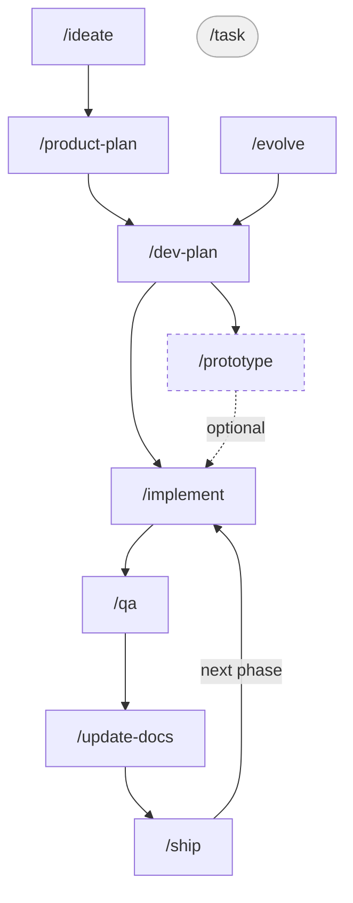

# rubstack

Rubén's software factory for Claude Code: a skill chain that takes a product from idea to shipped release, shared engineering rules, and guard hooks. The same plugin runs on your machine and in [Claude Code cloud sessions](https://code.claude.com/docs/en/claude-code-on-the-web).

rubstack started as a Claude Code–only rework of [harness](https://github.com/RubenGlez/harness).

## Install

rubstack is installed through your claude.ai account, so it follows you everywhere you sign in:

1. Open [claude.ai → Customize → Plugins](https://claude.ai/customize/plugins), choose **Add → Add marketplace**, and enter `RubenGlez/rubstack`. The repo is private, so connect GitHub and give the Claude GitHub App access to it when the dialog asks.
2. Add the `rubstack` plugin from that marketplace, and turn on **Sync automatically** so new releases arrive by themselves.
3. Start a new Claude Code session. The plugin loads as `rubstack@synced` — locally (Claude Code v2.1.273+, signed in with your claude.ai account) and in cloud sessions. Locally, run `/reload-plugins` if it synced after the session started.

Skills are invoked by name, like `/implement`. Use `/rubstack:implement` only if another plugin has a skill with the same name.

**Working on rubstack itself:** start Claude Code with `claude --plugin-dir /path/to/rubstack` to load your working copy for that session; it takes precedence over the synced copy.

## Cloud sessions

Two things need setting up once on your personal cloud environment (claude.ai/code → environment menu → Edit):

**Encrypted docs.** Cloud containers have no SSH key, so give rubstack a dedicated one:

```bash
# On your machine
ssh-keygen -t ed25519 -N "" -f ~/.ssh/rubstack_cloud -C rubstack-cloud
base64 < ~/.ssh/rubstack_cloud | tr -d '\n'        # value for RUBSTACK_DOCTIER_KEY

# In every project the cloud may read
doctier grant "$(cat ~/.ssh/rubstack_cloud.pub)" && git commit -am "chore: grant rubstack cloud key" && git push
```

Set `RUBSTACK_DOCTIER_KEY` as an environment variable on a **personal** environment. At session start, the plugin's SessionStart hook writes the key to `~/.ssh/rubstack_doctier`, runs `doctier init`, and decrypts `.rubstack/`.

Know the trade-off: environment variables are stored in plain text and any process in the session can read them. Use this key for nothing else, grant it only where cloud sessions need the docs, and revoke it (delete its line from `.doctier/recipients.txt`, then `doctier grant`) if it may have leaked — revocation protects later commits, not history.

**doctier binary (recommended).** Add this line to the environment's setup script so doctier is cached with the container instead of being downloaded at every session start:

```bash
curl -fsSL https://raw.githubusercontent.com/RubenGlez/doctier/main/install.sh | sh
```

**GitHub.** `gh` is not authenticated in cloud sessions; skills switch to the GitHub MCP tools automatically ([`skills/_shared/github-access.md`](skills/_shared/github-access.md)). Fleet-wide skills (`/address-cves`, `/migrate-docs` fleet mode) only reach repositories attached to the session, and Dependabot alert data is not available there.

## Skills

There are three entry points depending on where you are:



- **New product** — start with `/ideate`, then follow the chain down to `/ship`.
- **Feature or change on an existing product** — start with `/evolve`, pick up at `/dev-plan`, then continue the same chain.
- **Small fix or tweak** — run `/task` directly; it's a one-shot skill with no planning phase.

### New product workflow

Run these skills in order, from raw idea to shipped product. Each skill reads the documents the previous one wrote, so the chain is self-contained.

| Step | Skill | What it does | Documents |
|------|-------|--------------|-----------|
| 1 | `/ideate` | Research competitors and market viability on the web; decide whether to pursue the idea | Reads the user idea and web sources; writes `.rubstack/product/idea.md` |
| 2 | `/product-plan` | Define audience, positioning, features, roadmap, and UX through a structured interview | Reads `idea.md`, existing product docs, and the codebase; writes `.rubstack/product/product.md`, `roadmap.md`, `competitors.md`, `ux.md`, and `CONTEXT.md` |
| 3 | `/dev-plan` | Decide architecture, stack, and generate a technical spec for every must-have feature, with Given/When/Then acceptance criteria | Reads `.rubstack/product/*`, the codebase, and existing engineering docs; writes `.rubstack/engineering/architecture.md`, `implementation-plan.md`, `features/*.md`, and optional ADRs |
| 4 | `/prototype` | Build throwaway code to answer a specific design question before committing to an approach | Reads the relevant `features/*.md`; writes prototype findings back to the feature spec and optional ADRs |
| 5 | `/implement` | Classify features as HITL/AFK, then implement the current phase as parallel vertical slices | Reads architecture, implementation plan, feature specs, ADRs, and `CONTEXT.md`; writes code changes |
| 6 | `/qa` | Build a feedback loop, test all acceptance criteria, fix simple failures, flag architectural gaps | Reads feature specs, UX docs, README, and test/run config; writes `.rubstack/qa/report.md` |
| 7 | `/update-docs` | Sync all documentation — internal and public — with the current state of the project | Reads git history, `.rubstack/*`, public docs, and the codebase; updates stale internal and public docs |
| 8 | `/ship` | Pre-flight checks, version bump and tag, changelog, deploy, and verify the release live | Reads the QA report, release config, and git history; writes the version bump, changelog or tag notes, and roadmap updates |

Step 4 (`/prototype`) is optional — use it when a feature carries high technical uncertainty.
Steps 5–7 repeat for each phase of the roadmap; `/ship` closes out a phase when it's ready for users.

### Evolving an existing product

When the product is already shipped and you want to add a feature, change behavior, or introduce a new nuance, run `/evolve` first. It reads the existing product context, interviews you on the change from a product perspective (audience fit, scope, competitive angle, roadmap priority), updates the relevant harness docs, and hands off to `/dev-plan` for the engineering conversation.

The flow from there is the same as the new product chain: `/dev-plan → /implement → /qa → /update-docs → /ship`.

Use `/task` instead when the change is small enough that no product conversation is needed — a bug fix, a behavior tweak, or a micro-feature.

### Starting mid-flow

If you have an existing project with scattered docs — a `docs/` folder, a `SPEC.md`, an `ARCHITECTURE.md`, notes spread across the repo — run `/migrate-docs` first. It finds everything, classifies it, and migrates it into the rubstack workflow in one pass.

If the project has code but no docs at all, skip `/ideate` and start with `/product-plan` — it reads the codebase first and reconstructs context from what's already built.

If you are unsure which skill comes next, run `/next-step` first. It inspects the repo and current docs, then recommends the next rubstack skill.

### Day-to-day changes

Once a product is shipped, most work is small: a bug report, a tweak, a customer request. Run `/task` for these — it makes the change as one verified slice and syncs the affected feature spec on the way out, so `.rubstack/` docs stay accurate between phases without re-running the planning skills. If the request turns out to be bigger than it looked, `/task` escalates to `/evolve` instead of proceeding.

### Private docs: `.rubstack/` and doctier

Every workflow skill stores internal docs (product vision, specs, ADRs, QA reports) under `.rubstack/`, tracked in git as [doctier](https://github.com/RubenGlez/doctier)-encrypted blobs — private in public repos, but still backed up, merged, and visible in every worktree. The entry skills (`/ideate`, `/product-plan`, `/migrate-docs`) scaffold `.doctier.yml` on first use and grant your SSH key. A fresh clone on your machine sees ciphertext until you run `doctier init` once and then `doctier unlock`; cloud sessions do this for you (see [Cloud sessions](#cloud-sessions)).

### Utilities

These can be used at any point in the workflow.

| Skill | What it does |
|-------|--------------|
| `/evolve` | Product interview for a feature addition or change on an existing product; updates docs and hands off to `/dev-plan` |
| `/task` | Small change on a shipped product: classify, fix, verify, sync the feature spec. Bugs, refactors and perf fixes follow a step-by-step playbook |
| `/review-diff` | Two-axis review of a diff: repo standards plus a code-smell baseline, and conformance to the feature spec, run as separate subagents |
| `/interrogate` | Adversarial review: parallel adversaries try to break a change, and only findings proven by a run are reported |
| `/next-step` | Inspect the repo and docs to recommend the next rubstack skill |
| `/migrate-docs` | Discover all existing docs in the repo and migrate them to the rubstack structure; moves harness projects from `.harness/` to `.rubstack/`; fleet mode migrates many repos in one sweep |
| `/handoff` | Compact the current session state into a temp-file for the next agent or session |
| `/zoom-out` | Map all relevant modules and their callers in an unfamiliar area of code |
| `/improve-codebase-architecture` | Find deepening opportunities: refactors that turn shallow modules into deep ones, improving testability and AI-navigability |
| `/metrics` | Fleet-wide traction and discoverability review across every non-archived repo and its publications; scores the previous run's recommendations before issuing new ones |
| `/write-a-skill` | Create a new rubstack skill with proper structure, progressive disclosure, and bundled resources |

## What else is included

| Component | Where | Purpose |
|---|---|---|
| Rules | `rules/rules.md` | Engineering and git rules, injected into every session by the SessionStart hook |
| Guard hooks | `scripts/hooks/block-dangerous-git.sh`, `block-prototype-commit.sh` | Block irreversible git commands and commits of prototype/spike code |
| Design lint | `scripts/hooks/lint-design.sh` | Lints `DESIGN.md` after each edit |
| Session start | `scripts/hooks/session-start.sh` | Rules, cloud doctier unlock, and workflow status |

## Migrating from harness

1. Remove harness: `bash uninstall.sh` in your harness clone (it also removes the harness rules block from `~/.claude/CLAUDE.md`, which rubstack now injects itself).
2. Install rubstack as above.
3. In each project, run `/migrate-docs`: it moves `.harness/` to `.rubstack/` and keeps the docs encrypted.

## Status

`/metrics` still keeps its state in `~/.rubstack/metrics/` and has no schedule yet; moving it to a weekly cloud Routine is the next planned change.

## Acknowledgements

- **[Matt Pocock's skills](https://github.com/mattpocock/skills)**: several patterns in this repo are directly inspired by his work — the HITL/AFK classification and vertical slice model (`/implement`) come from `to-issues`; the feedback-loop-first approach and post-mortem (`/qa`) come from `diagnose`; the behavioral testing principle comes from `tdd`; the domain glossary pattern (`CONTEXT.md`) and ADR creation rules come from `grill-with-docs`; the `/prototype`, `/handoff`, and `/zoom-out` skills are adapted from his originals; the `/task` bug-fix loop comes from `diagnosing-bugs`; `/review-diff` comes from `code-review`; and the invocation and completion-criteria guidance in `/write-a-skill` comes from `writing-for-agents`. The PR body shape in `rules/rules.md` comes from his `pr` skill, itself credited to Dex Horthy's `show-me`.
- **[Andrej Karpathy's CLAUDE.md](https://github.com/multica-ai/andrej-karpathy-skills/blob/main/CLAUDE.md)**: the behavioral guidelines in `rules/rules.md` (Think Before Coding, Simplicity First, Surgical Changes, Goal-Driven Execution) are adapted from his work.
- **[pstack](https://github.com/cursor/plugins/tree/main/pstack)** by Lauren Tan: the engineering principles in `rules/rules.md`, the `/task` playbooks, and `/interrogate` (findings only count when a run proves them) are adapted from it.
