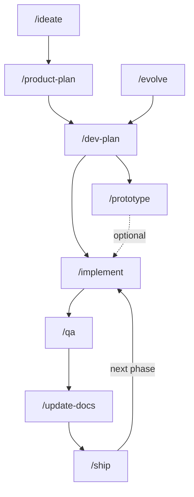

# rubstack

Rubén's software factory for Claude Code: a chain of skills that takes a product from idea to shipped release, plus guard hooks. It runs the same on your machine and in [Claude Code cloud sessions](https://code.claude.com/docs/en/claude-code-on-the-web). It started as a Claude Code–only rework of [harness](https://github.com/RubenGlez/harness).

## Install

1. In [claude.ai → Customize → Plugins](https://claude.ai/customize/plugins), choose **Add → Add marketplace** and enter `RubenGlez/rubstack`.
2. Add the `rubstack` plugin and turn on **Sync automatically**.
3. Start a new session. It loads as `rubstack@synced` locally (Claude Code v2.1.273+, signed in with claude.ai) and in the cloud. Run `/reload-plugins` if it synced mid-session.

Signed in with an API key instead? Install per machine: `/plugin install rubstack --marketplace RubenGlez/rubstack`.

Call skills by name (`/implement`); use `/rubstack:implement` only on a name clash. To work on rubstack itself, run `claude --plugin-dir /path/to/rubstack`.

## Workflow



Where to start:

- **New product:** `/ideate`.
- **Code but no docs:** `/product-plan` (it reads the codebase first). Scattered docs: `/migrate-docs` first.
- **New feature on a shipped product:** `/evolve`, then `/dev-plan`.
- **Bug fix, tweak, small feature:** `/task`. It escalates to `/evolve` if the change is bigger than it looked.
- **Not sure:** `/next-step`.

| Skill | What it does | Writes |
|---|---|---|
| `/ideate` | Researches the market and decides whether to pursue the idea | `product/idea.md` |
| `/product-plan` | Interviews you on audience, positioning, features, roadmap and UX | `product/*.md`, `CONTEXT.md` |
| `/evolve` | Product interview for a change to a shipped product | updates `product/*.md` |
| `/dev-plan` | Architecture, stack, and a spec with Given/When/Then criteria per feature | `engineering/architecture.md`, `implementation-plan.md`, `features/*.md`, ADRs |
| `/prototype` | Optional: throwaway code to answer one design question | findings in the feature spec |
| `/implement` | Implements the current phase as parallel vertical slices (static checks only) | code |
| `/qa` | Tests every acceptance criterion, fixes simple failures, flags gaps | `qa/report.md` |
| `/update-docs` | Syncs internal and public docs with the code | stale docs |
| `/ship` | Pre-flight, version and tag, changelog, deploy, live check | release, roadmap |

Paths are under `.rubstack/`. `/implement → /qa → /update-docs` repeats per roadmap phase; `/ship` closes a phase.

### Other skills

| Skill | What it does |
|---|---|
| `/task` | One small change as a verified slice, syncing its feature spec; playbooks for bugs, refactors and perf |
| `/review-diff` | Reviews a diff against repo standards and against the feature spec |
| `/interrogate` | Adversaries try to break a change; only findings proven by a run count |
| `/next-step` | Recommends the next skill from the repo and docs |
| `/migrate-docs` | Moves existing docs (or a harness `.harness/` folder) into `.rubstack/`; fleet mode for many repos |
| `/handoff` | Writes a handoff document so the next session can continue |
| `/zoom-out` | Maps the modules and callers in an unfamiliar area |
| `/improve-codebase-architecture` | Finds refactors that turn shallow modules into deep ones |
| `/address-cves` | Finds and fixes high and critical dependency CVEs across all your repos |
| `/metrics` | Fleet-wide traction review; scores last run's recommendations |
| `/write-a-skill` | Creates a new rubstack skill |

## Project docs: `.rubstack/`

Skills keep product and engineering docs in `.rubstack/`, tracked in git ([doc-store.md](skills/_shared/doc-store.md)):

- **Private repos:** plain files, nothing to set up.
- **Public repos:** encrypted with [doctier](https://github.com/RubenGlez/doctier); `/ideate`, `/product-plan` and `/migrate-docs` set it up. A fresh clone needs `doctier init` and `doctier unlock` once.

Before making a private repo public, purge `.rubstack/` from its history: old commits hold it in plaintext.

## Hooks

- **Guards:** block irreversible git commands and commits of prototype code.
- **Design lint:** checks `DESIGN.md` after each edit.
- **Session start:** shows workflow status and, in the cloud, decrypts `.rubstack/` in public repos.

## Cloud sessions

`gh` is not authenticated in the cloud, so skills use the GitHub MCP tools instead ([github-access.md](skills/_shared/github-access.md)). Fleet-wide skills only reach repos attached to the session, and Dependabot alerts are unavailable.

Public repos only: to read encrypted docs in the cloud, give it a dedicated key.

```bash
ssh-keygen -t ed25519 -N "" -f ~/.ssh/rubstack_cloud -C rubstack-cloud
base64 < ~/.ssh/rubstack_cloud | tr -d '\n'   # paste as RUBSTACK_DOCTIER_KEY
```

```bash
doctier grant "$(cat ~/.ssh/rubstack_cloud.pub)"   # in each public repo, then commit and push
```

In claude.ai/code → environment → Edit, on a **personal** environment:

- Set `RUBSTACK_DOCTIER_KEY` to the value above. Any process in the session can read it, so use the key for nothing else. To revoke it, delete its line from `.doctier/recipients.txt` and run `doctier grant` (protects later commits only).
- Add `curl -fsSL https://raw.githubusercontent.com/RubenGlez/doctier/main/install.sh | sh` to the setup script, so doctier is cached instead of downloaded each session.

## Metrics

`/metrics` keeps its state (config, bets, weekly snapshots) in the database of a private Artifact titled "rubstack metrics", never in a repo. Each run pulls it to `~/.rubstack/metrics` with ArtifactData, runs `skills/metrics/scripts/weekly.sh`, and pushes the new snapshot and any state changes back. A weekly cloud Routine whose prompt does that pull and push runs it without GitHub access; run `/metrics` locally at least every 14 days so GitHub traffic data isn't lost.

## Migrating from harness

1. On your machine, run `bash migration/from-harness.sh` from a clone of this repo. It copies harness metrics state to `~/.rubstack/metrics` for the next `/metrics` run to upload, uninstalls harness, and creates the cloud key. Safe to re-run.
2. In each project, run `/migrate-docs` (or its fleet mode from your workspace).

## Credits

- [Matt Pocock's skills](https://github.com/mattpocock/skills): HITL/AFK slices in `/implement` (`to-issues`), the feedback loop in `/qa` (`diagnose`), `CONTEXT.md` and ADRs (`grill-with-docs`), the `/task` bug-fix loop (`diagnosing-bugs`), `/review-diff` (`code-review`), `/write-a-skill` guidance (`writing-for-agents`), the PR body shape in `_shared/git-workflow.md` (`pr`, after Dex Horthy's `show-me`), and `/prototype`, `/handoff` and `/zoom-out`.
- [Andrej Karpathy's CLAUDE.md](https://github.com/multica-ai/andrej-karpathy-skills/blob/main/CLAUDE.md): behavioral guidelines folded into the skills and `_shared/principles/`.
- [pstack](https://github.com/cursor/plugins/tree/main/pstack) by Lauren Tan: `_shared/principles/`, the `/task` playbooks, and `/interrogate`.
